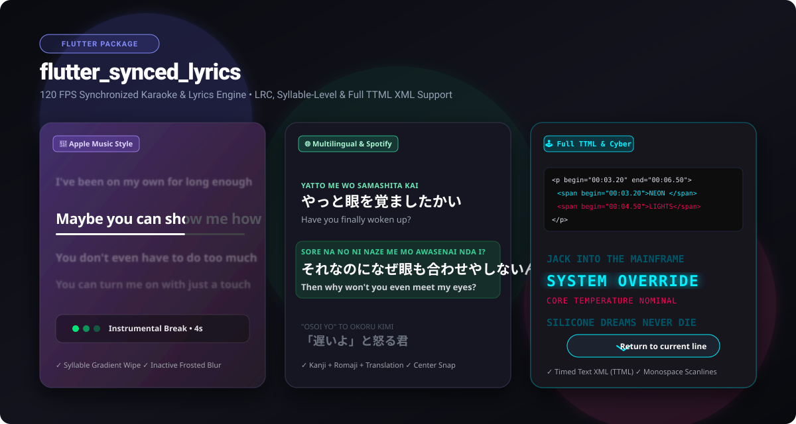

# flutter_synced_lyrics

<p align="center">
  <a href="https://pub.dev/packages/flutter_synced_lyrics"></a>
  <a href="https://pub.dev/packages/flutter_synced_lyrics/score"></a>
  <a href="https://govindtank.github.io/flutter_synced_lyrics/"></a>
  <a href="https://github.com/govindtank/flutter_synced_lyrics"></a>
  <a href="https://github.com/govindtank/flutter_synced_lyrics/blob/main/LICENSE"></a>
  <a href="https://buymeacoffee.com/govindtanko"></a>
  <a href="https://github.com/sponsors/govindtank"></a>
</p>

<p align="center">
  <strong>High-performance 120 FPS synchronized lyrics and karaoke engine for Flutter.</strong><br>
  Pixel-perfect syllable gradient wiping, Apple Music &amp; Spotify presets, complete pure-Dart TTML XML and Enhanced Syllable LRC parser, multilingual dual-track subtitles, and dynamic ambient backdrops.
</p>

---

<p align="center">
  <a href="https://govindtank.github.io/flutter_synced_lyrics/">
    
  </a>
</p>

<p align="center">
  <a href="https://govindtank.github.io/flutter_synced_lyrics/">
    
  </a>
</p>

---

## ⚡ Highlights & Real Capabilities

* 🎙️ **Syllable-by-Syllable Karaoke Fill**: Dual-layer clipping shader with sub-frame time interpolation for liquid-smooth 120 FPS word wiping.
* 📜 **Full-Featured Pure-Dart TTML Parser**: Native W3C and Apple Music TTML XML parser supporting `<p begin="" end="">` lines, `<span begin="" end="">` word tokens, and clock/offset timestamps (`00:01:23.450`, `4.5s`, `4500ms`).
* ⏱️ **Standard & Enhanced Syllable LRC**: Seamlessly parses `[mm:ss.xx]` lines, fine-grained `<mm:ss.xx> word <mm:ss.xx>` timestamps, metadata tags (`[ti:]`, `[ar:]`, `[offset:]`), and repeated timestamps.
* 🌐 **Multilingual Subtitle Tracks**: Native 3-tier track rendering per line: **Original Lyric + Romanization/Phonetics (Romaji, Pinyin, Furigana) + Translated Meaning**.
* 🎨 **5 Trending Visual Presets**:
  * **Apple Music**: Syllable gradient wipe, 1.10x active spring zoom, and frosted blur on inactive lines.
  * **Spotify**: High-contrast bold typography, center snap alignment, and dimmed inactive lines.
  * **Musixmatch**: High-energy neon yellow/green fill, word bounce & glow.
  * **Cyberpunk HUD**: Monospace typography, cyan neon bloom, and magenta accents.
  * **Minimalist Hi-Fi Vinyl**: Refined serif typography with editorial rhythm.
* 🧭 **Smart Auto-Scroll & Exploration**: Automatically pauses auto-scrolling when the user touches or drags the lyrics to browse upcoming verses, and displays a floating **"Return to current line"** snap-back pill with configurable idle resume timeout.
* 🎸 **Instrumental Break Handling**: Automatically detects musical pauses (>4s) between verses and renders animated pulsing visualizer dots and remaining countdown seconds.
* 📱 **Companion Widgets Included**:
  * `MiniLyricsBar`: Compact single or dual-line marquee/flipper for bottom mini-players and car dashboards.
  * `AmbientLyricsBackdrop`: Dynamic reactive blurred ambient mesh canvas that glows behind lyrics.
* 🚀 **Zero Dependency Lock-In**: Works out of the box with `just_audio`, `audioplayers`, `flutter_sound`, Web Audio, or custom stream controllers. Zero external runtime dependencies in the core package.

---

## 📦 Installation

Add `flutter_synced_lyrics` to your `pubspec.yaml`:

```yaml
dependencies:
  flutter_synced_lyrics: ^1.0.0
```

Then import the package:

```dart
import 'package:flutter_synced_lyrics/flutter_synced_lyrics.dart';
```

---

## 🚀 Quick Start

### 1. Initialize Controller & Bind Audio Stream

```dart
// Parse from any format (Standard LRC, Syllable LRC, TTML XML, or JSON)
final controller = LyricsController.fromSource(
  rawLyricsString,
  config: const LyricsConfig(
    autoScroll: true,
    activeLineAnchor: 0.42, // Optimal eye-level reading anchor
    idleTimeoutBeforeResume: Duration(seconds: 3),
  ),
  onSeekRequest: (seekTarget) {
    // Jump audio player when user taps any lyric line or syllable
    audioPlayer.seek(seekTarget);
  },
);

// Stream playback position directly from your player
audioPlayer.positionStream.listen((position) {
  controller.progress = position;
});
```

### 2. Embed `LyricsView`

```dart
LyricsView(
  controller: controller,
  theme: LyricsPreset.appleMusic(),
  showTranslation: true,
  showRomanization: true,
)
```

---

## 🎨 Visual Style Presets

Switch between trending music streaming designs with a single parameter:

```dart
// 1. Apple Music Style (Fluid Karaoke Wipe + Frosted Inactive Blur)
LyricsView(
  controller: controller,
  theme: LyricsPreset.appleMusic(
    activeColor: Colors.white,
    highlightColor: Colors.amberAccent,
    activeScale: 1.12,
    blurInactive: true,
  ),
);

// 2. Spotify Style (High Contrast Center Snap)
LyricsView(
  controller: controller,
  theme: LyricsPreset.spotify(
    activeColor: Colors.white,
    textAlign: TextAlign.center,
  ),
);

// 3. Cyberpunk Synthwave HUD
LyricsView(
  controller: controller,
  theme: LyricsPreset.cyberpunk(
    cyan: Color(0xFF00F0FF),
    magenta: Color(0xFFFF0055),
  ),
);

// 4. Musixmatch Stage Neon
LyricsView(
  controller: controller,
  theme: LyricsPreset.musixmatch(),
);

// 5. Minimalist Hi-Fi Vinyl (Editorial Serif)
LyricsView(
  controller: controller,
  theme: LyricsPreset.minimalistVinyl(),
);
```

---

## 📜 Full TTML XML Support

`flutter_synced_lyrics` natively parses standard W3C Timed Text Markup Language (TTML) and Apple Music XML files without requiring external XML packages:

```xml
<?xml version="1.0" encoding="utf-8"?>
<tt xmlns="http://www.w3.org/ns/ttml" xmlns:ttm="http://www.w3.org/ns/ttml#metadata">
  <head>
    <metadata>
      <ttm:title>Blinding Lights</ttm:title>
      <ttm:artist>The Weeknd</ttm:artist>
    </metadata>
  </head>
  <body>
    <div>
      <p begin="00:00:03.200" end="00:00:06.500">
        <span begin="00:00:03.200" end="00:00:04.000">I've </span>
        <span begin="00:00:04.000" end="00:00:04.800">been </span>
        <span begin="00:00:04.800" end="00:00:05.600">tryin' </span>
        <span begin="00:00:05.600" end="00:00:06.500">to call</span>
      </p>
    </div>
  </body>
</tt>
```

```dart
final doc = LyricsParser.fromTtml(ttmlXmlString);
final controller = LyricsController(document: doc);
```

---

## 🌐 Multilingual Dual-Track Subtitles

Display original lyrics alongside romanized readings (Romaji, Pinyin, Furigana) and translated subtitles simultaneously:

```
[00:02.00]やっと眼を覚ましたかい
[00:02.00]Have you finally woken up?
[00:07.00]それなのになぜ眼も合わせやしないんだい？
[00:07.00]Then why won't you even meet my eyes?
```

Both lines are automatically linked, synchronized, and rendered with hierarchical typography:

```dart
LyricsView(
  controller: controller,
  showTranslation: true,
  showRomanization: true,
)
```

---

## 📱 Compact Mini Player Bar

For persistent bottom sheets, car displays, or notification cards:

```dart
MiniLyricsBar(
  controller: controller,
  showTranslation: true,
  onTap: () {
    // Open full-screen lyrics modal
    showModalBottomSheet(
      context: context,
      isScrollControlled: true,
      builder: (ctx) => LyricsView(controller: controller),
    );
  },
)
```

---

## ⚙️ API Reference

### `LyricsConfig`

| Property | Type | Default | Description |
| :--- | :--- | :--- | :--- |
| `autoScroll` | `bool` | `true` | Enables automatic scrolling to keep the active line in view. |
| `activeLineAnchor` | `double` | `0.42` | Viewport alignment anchor (`0.0` top, `0.5` center, `1.0` bottom). |
| `scrollDuration` | `Duration` | `550ms` | Transition duration when animating to the next line. |
| `scrollCurve` | `Curve` | `Curves.easeOutCubic` | Easing curve for smooth scroll transitions. |
| `idleTimeoutBeforeResume` | `Duration?` | `3.5s` | Inactivity timer before manually dragged lyrics snap back. Set `null` to require tapping the snap chip. |
| `latencyOffset` | `Duration` | `Duration.zero` | Global calibration offset added to audio timestamps (e.g. for Bluetooth delay). |
| `instrumentalBreakThreshold`| `Duration` | `4s` | Minimum verse gap before triggering visualizer countdown dots. |
| `enableHaptics` | `bool` | `false` | Triggers subtle haptic feedback clicks on line changes. |

### `LyricsController`

| Method / Getter | Returns | Description |
| :--- | :--- | :--- |
| `setProgress(Duration pos)` | `void` | Sets the current audio position (notifies active line/syllable). |
| `seek(Duration pos)` | `void` | Triggers seek callback and updates internal position. |
| `resumeAutoScroll()` | `void` | Snaps immediately back to the active line. |
| `setDocument(doc)` | `void` | Swaps the lyrics document upon track change. |
| `setLatencyOffset(offset)` | `void` | Updates calibration offset dynamically. |
| `currentLine` | `LyricLine?` | Currently active line object. |
| `currentSyllable` | `LyricSyllable?` | Currently active syllable object. |
| `isInstrumentalBreak` | `bool` | True when in a musical gap exceeding threshold. |

---

## 🔗 Related Packages by Author

* **[waveform_pro](https://pub.dev/packages/waveform_pro)** — Production-grade GPU-accelerated audio waveform timeline and visualizer.
* **[ambient_backdrop_glow](https://pub.dev/packages/ambient_backdrop_glow)** — Dynamic ambient backdrop glow and fluid animated mesh gradients from image artwork with OKLab color blending.
* **[flutter_smooth_marquee](https://pub.dev/packages/flutter_smooth_marquee)** — Performance-first marquee and auto-scrolling ticker with zero CPU waste on static text.
* **[android_island_bar](https://pub.dev/packages/android_island_bar)** — Universal cross-platform island overlay with hardware cutout snapping.
* **[flutter_sonner](https://pub.dev/packages/flutter_sonner)** — Opinionated stacked action toast & notification HUD inspired by Sonner.
* **[ai_voice_orb](https://pub.dev/packages/ai_voice_orb)** — Fluid neural voice orb for Conversational AI & voice agents.
* **[tactile_fluid_slider](https://pub.dev/packages/tactile_fluid_slider)** — Physics-driven tactile fluid slider with spring morphing.

---

## 💖 Support the Project

If you find this package useful in your music players, karaoke apps, or production Flutter projects, consider supporting its active maintenance and future development:

<p align="left">
  <a href="https://buymeacoffee.com/govindtanko"></a>
  <a href="https://github.com/sponsors/govindtank"></a>
  <a href="https://www.patreon.com/govindtank"></a>
</p>

---

## 📄 License

This project is licensed under the Apache License 2.0 - see the [LICENSE](LICENSE) file for details.

*Maintained with ❤️ by [Govind Tank](https://github.com/govindtank).*
